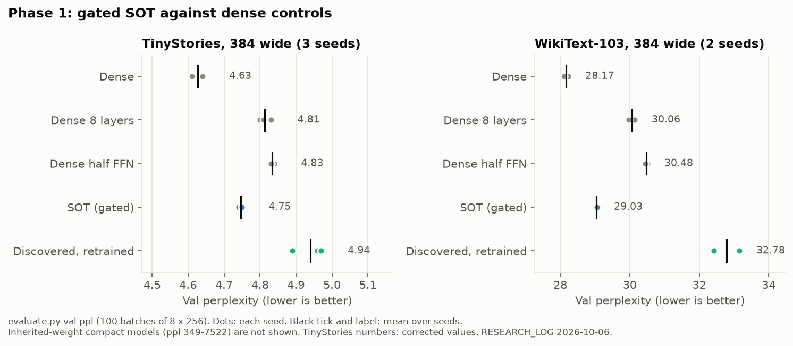
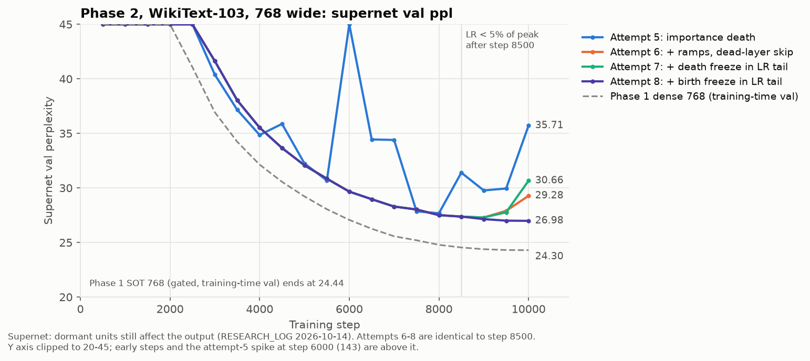
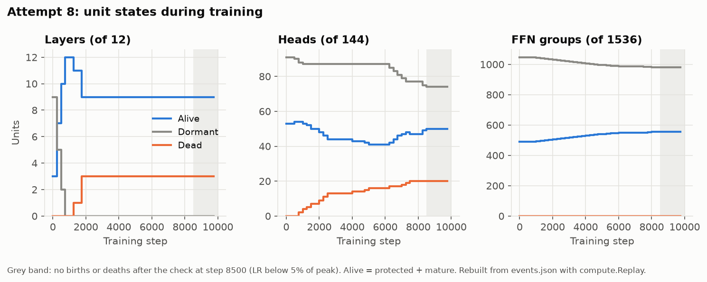
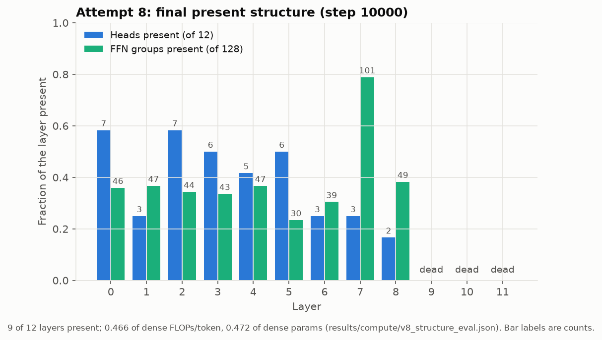
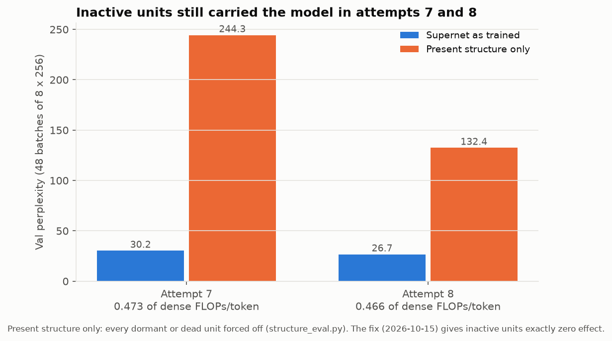

# Self-Organising Transformer

Can a Transformer learn its own structure while it learns its weights,
and end up cheaper than a dense model of the same quality?

This repository is a research experiment that tests that question. A
model starts over-complete (Phase 1) or small (Phase 2). During language
model training it decides which layers, attention heads, FFN channel
groups and skip edges to keep. There is no separate architecture search.

**Status (2026-10-16): no result yet shows a cheaper model at equal
quality.** The work so far found the mechanisms that do not work, and
several bugs that made earlier results look better than they were. The
full record is in [`RESEARCH_LOG.md`](RESEARCH_LOG.md). Read its summary
first.

## Results so far

### Phase 1: differentiable gates

Every layer, head, FFN group and skip edge has a sigmoid gate. A budget
on the gate-weighted cost pushes gates down.



- The gated model (SOT) trails the dense model by 2-4% perplexity, on
  both datasets and every seed. At d_model 768 on WikiText-103 the gap is
  0.1% (22.00 against 21.98).
- The gate-weighted "cost" reads 0.12-0.13 of dense. This is not compute:
  the gated model runs every tensor. A physically smaller model with the
  inherited weights collapses (ppl 349-881 on TinyStories).
- The discovered structure, retrained from scratch, loses to the dense
  model. On WikiText-103 it also loses to a plain 8-layer dense model.
- A gate value does not measure importance. Selection by gate drops
  layer 0, which is the most important layer. A Taylor estimate
  `|g * dL/dg|` tracks the real importance.

### Phase 2: discrete birth and death

Training starts with 33% of units alive. Every 250 steps a controller
gives birth to promising dormant units and kills alive units that fall
behind. Eight full runs on WikiText-103 (d_model 768) fixed the controller
step by step.





Attempt 8 ends with 9 of 12 layers and a present structure of 0.466 of
dense FLOPs per token:



**But the curves above are supernet numbers.** In attempts 1-8, dormant
and dead units still had small non-zero gates, and they still trained.
With every unit outside the present structure forced off, attempt 8 goes
from 26.7 to 132 val ppl:



The code now gives dormant and dead units exactly zero effect and zero
gradient (2026-10-15, `tests/zero_effect_test.py`). No full-scale run uses
it yet. That run (attempt 9) is the next step. See "Where next" in
[`RESEARCH_LOG.md`](RESEARCH_LOG.md).

### Text samples

From [`docs/samples.md`](docs/samples.md) (temperature 0.8, top-k 50,
first run, not chosen):

> **TinyStories dense (d 384):** Once upon a time, there was a little dog
> named Max. Max loved to play in the park with his friends. They would
> run and jump and have so much fun. One day, Max met a little girl named
> Lily. Lily was sad because she lost her favorite toy. Max said, "Don't
> worry, I will help you find it."

> **WikiText-103 dense (d 768):** The history of the city begins in the
> 1st century , with its name from the Roman era . The walls of the
> citadel , which was built on the site of the old Roman fort , were
> built by St. John the Baptist .

> **Phase 2 attempt 8, present structure only:** The history of the city
> begins in the the opening gate , is now a a long long , and the the the
> the that that it opened , and the " " " " " " ...

The TinyStories models write fluent stories. The WikiText-103 models
write fluent text with invented facts. The present structure of attempt 8
alone breaks down after a few words.

## Quickstart

Python 3.12 or later. `transformers` must be below 5.0: version 5.x
corrupts the reload of these custom models.

```bash
git clone https://github.com/sbartlett97/self-organising-transformer
cd self-organising-transformer
python -m venv .venv
source .venv/bin/activate
pip install -r requirements.txt
```

On a CUDA machine, install the correct PyTorch wheel first if you need a
special build.

### Generate text with a trained model

The model classes are not registered with `AutoModel`. The Hub widget
and `AutoModelForCausalLM` do not work. Use this repository's code:

```bash
python generate.py sbartlett97/sot-phase1-tinystories-dense-seed42 \
    --prompt "Once upon a time, there was a little dog named"

python generate.py sbartlett97/sot-phase1-wikitext103-dense-seed42-tc768d013 \
    --prompt "The history of the city begins in" --temperature 0.8 --top_k 50
```

`generate.py` takes a Hub repo id or a local checkpoint directory. It
works for all three model classes. Options: `--max_new_tokens`,
`--temperature` (0 is greedy), `--top_k`, `--seed`, `--num_samples`,
`--device`.

To use a model from Python:

```python
from ablation_importance import resolve_checkpoint   # downloads a Hub repo
from evaluate import load_model                       # picks the right class
from transformers import AutoTokenizer

path = resolve_checkpoint("sbartlett97/sot-phase1-tinystories-sot-seed42")
model = load_model(str(path), None).eval()
tok = AutoTokenizer.from_pretrained(path)
out = model(tok("Once upon a time", return_tensors="pt").input_ids)
print(out["logits"].shape)
```

Older Phase 2 checkpoints print a "newly initialized" warning for the
`*_scale` and `*_probe*` keys. This is expected. Those buffers take their
defaults (scale 1), so the model loads as it was trained.

### Run the tests

The tests are plain scripts. Each prints PASS lines and ends with an
error if a check fails.

```bash
python tests/zero_effect_test.py         # inactive units: zero output, zero gradient
python tests/phase2_controller_test.py   # birth/death controller
python tests/compute_test.py             # FLOPs and parameter counts
```

### Train

Phase 1 (gated supernet, or a dense baseline):

```bash
python train.py --model_type sot --output_dir outputs/sot --max_steps 10000
python train.py --model_type dense --output_dir outputs/dense --max_steps 10000
```

The default dataset is TinyStories. For WikiText-103, add
`--dataset_name wikitext --dataset_config wikitext-103-raw-v1`. For a
smoke test, use `--max_steps 50 --eval_every 25 --save_every 25`.

`./run_experiment.sh` runs the full Phase 1 matrix for one seed: three
dense baselines, SOT, the compact model and the retrained compact model.

Phase 2 (birth and death), with the settings of attempt 8 and the
zero-effect code:

```bash
python train_phase2.py --output_dir outputs/phase2 \
    --dataset_name wikitext --dataset_config wikitext-103-raw-v1 \
    --d_model 768 --max_heads 12 --max_ffn_dim 3072 --ffn_groups 128 \
    --target_cost 0.13 --seed_fraction 0.33 --growth_interval 250 \
    --birth_limit 4 --birth_limit_end 1 --death_limit 2 --minimum_age 500 \
    --death_criterion importance --death_relative_margin 0.6 --death_patience 2 \
    --birth_score_floor 0 --birth_ramp_steps 250 --death_ramp_steps 250 \
    --death_freeze_lr_fraction 0.05 --birth_freeze_lr_fraction 0.05 \
    --max_steps 10000
```

A full run of this command takes about 2.5 hours on one A100 80GB.

### Evaluate and inspect

```bash
# Perplexity and lm-eval tasks (hellaswag, arc_easy, piqa, winogrande)
python evaluate.py outputs/sot/final --results outputs/sot/evaluation.json

# Phase 1: build a physically smaller model, then retrain that shape from scratch
python materialize.py outputs/sot/final --output_dir outputs/sot_compact
python retrain_compact.py outputs/sot_compact --output_dir outputs/discovered_retrained

# Phase 2: FLOPs, params and val ppl of the present structure
python structure_eval.py <checkpoint> --events <run>/events.json --death_ramp_steps 250
```

`compute.py` counts real matmul FLOPs and parameters for any structure.
`compact_model.build_from_plastic(model)` builds the physical model of a
Phase 2 checkpoint's present structure.

### Make the figures

```bash
pip install -r requirements-dev.txt
python scripts/make_figures.py   # writes docs/figures/*.png from results/
```

## Models on the Hugging Face Hub

All checkpoints are under [huggingface.co/sbartlett97](https://huggingface.co/sbartlett97),
in three collections:

- [SOT phase1 — tinystories](https://huggingface.co/collections/sbartlett97/sot-phase1-tinystories-6ac4cbf24224063cb605659f):
  3 seeds of every Phase 1 condition, d 384.
- [SOT phase1 — wikitext103](https://huggingface.co/collections/sbartlett97/sot-phase1-wikitext103-6ac4c7087f6073e1aef8d6b4):
  d 384 at two budgets, and the d 768 dense and SOT baselines.
- [SOT phase2 — wikitext103](https://huggingface.co/collections/sbartlett97/sot-phase2-wikitext103-6ac76aa938b7496cb8352d03):
  Phase 2 attempts 4-8, d 768.

Good models to start with:

| model | what it is | val ppl |
|---|---|---:|
| [`sot-phase1-tinystories-dense-seed42`](https://huggingface.co/sbartlett97/sot-phase1-tinystories-dense-seed42) | dense baseline, 48M params | 4.63 |
| [`sot-phase1-tinystories-sot-seed42`](https://huggingface.co/sbartlett97/sot-phase1-tinystories-sot-seed42) | gated supernet | 4.75 |
| [`sot-phase1-tinystories-discovered_retrained-seed42`](https://huggingface.co/sbartlett97/sot-phase1-tinystories-discovered_retrained-seed42) | discovered structure, trained from scratch | 4.89 |
| [`sot-phase1-wikitext103-dense-seed42-tc768d013`](https://huggingface.co/sbartlett97/sot-phase1-wikitext103-dense-seed42-tc768d013) | dense baseline, 152M params | 21.98 |
| [`sot-phase1-wikitext103-sot-seed42-tc768d013`](https://huggingface.co/sbartlett97/sot-phase1-wikitext103-sot-seed42-tc768d013) | gated supernet, d 768 | 22.00 |
| [`sot-phase2-wikitext103-heuristic-seed42-tc768d013-v8-tailfreeze`](https://huggingface.co/sbartlett97/sot-phase2-wikitext103-heuristic-seed42-tc768d013-v8-tailfreeze) | Phase 2 attempt 8 (supernet) | 26.98 * |

Val ppl is `evaluate.py` perplexity. \* Training-time val ppl of the
supernet. The dense 768 model gives 24.30 on that method.

Every model card states its condition, its training settings, its
results and any known fault.

## Repository layout

| file | purpose |
|---|---|
| `model.py` | `SelfOrganizingTransformer`: the gated supernet (Phase 1) and dense baselines |
| `plastic_model.py` | `PlasticTransformer`: the Phase 2 model, with per-unit scales and birth probes |
| `plasticity.py` | `StructuralController`: unit lifecycle, birth and death rules, ramps, freezes |
| `compact_model.py` | `CompactTransformer`: physically smaller model; `build_from_sot`, `build_from_plastic` |
| `train.py`, `train_phase2.py` | training loops for Phase 1 and Phase 2 |
| `materialize.py`, `retrain_compact.py` | Phase 1 compaction and the from-scratch retrain control |
| `evaluate.py` | perplexity and lm-eval harness adapter |
| `generate.py` | text sampling from any checkpoint |
| `compute.py`, `structure_eval.py` | real FLOPs and params; quality of the present structure |
| `ablation_importance.py` | unit ablation, gate against importance |
| `hub_utils.py` | Hub upload, model cards, collections, Trackio |
| `tests/` | zero-effect, controller and compute tests |
| `results/` | raw run outputs (see [`results/README.md`](results/README.md)) |
| `scripts/make_figures.py` | the figures in this README |
| `notebooks/` | a Colab notebook for the Phase 1 gate diagnostic |

## Experiment design

The primary hypothesis: at equal training compute, an over-complete
Transformer with learned structure finds a heterogeneous topology that
matches a dense Transformer of the same envelope, at materially less
compute.

A positive result needs all of these:

1. Validation loss similar to or lower than the dense baseline.
2. Real compute (not a gate proxy) well below dense.
3. The discovered structure, retrained from scratch, recovers most of
   the quality.
4. The result holds across seeds.
5. The structure does not simply keep maximum capacity everywhere.
6. Quality holds in the physical model, not only in the masked supernet.

The controls are a dense model of the full envelope, dense models with
fewer layers or a narrower FFN, the compact model with inherited weights,
and the compact model retrained from scratch.

## License

Apache License 2.0. See [`LICENSE`](LICENSE).

## Citation

```bibtex
@misc{bartlett2026sot,
  author       = {Samuel Bartlett},
  title        = {Self-Organising Transformer: learning structure during training},
  year         = {2026},
  howpublished = {\url{https://github.com/sbartlett97/self-organising-transformer}}
}
```
